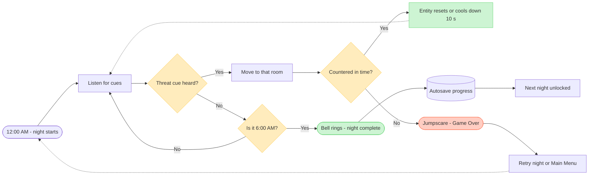
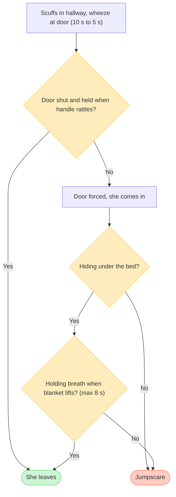
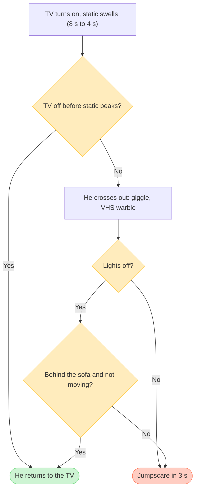
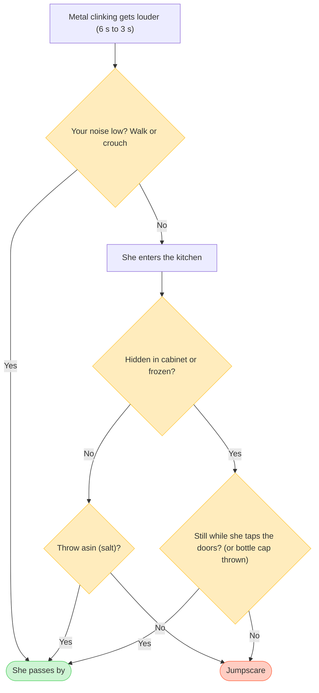
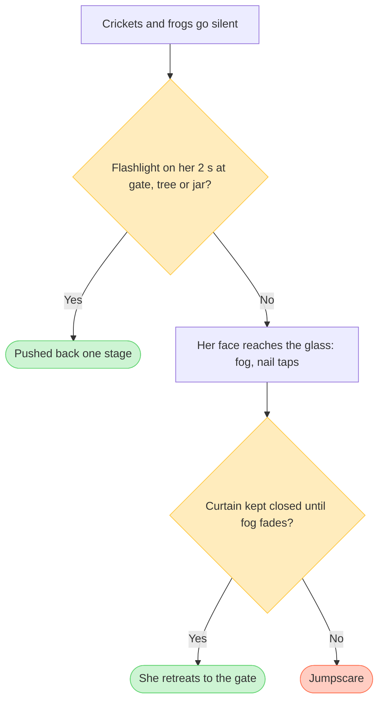

# Gameplay flow (if/else)

Every death traces back to a cue the player missed. Yellow = decision, green = survive, red = death.

## Night loop

Threat director: at most one entity in its fatal state on Nights 1–3, at most two on Nights 4–5. Two cues never start in the same second.

## Kumot (bedroom) · Batibat

## Malikmata (living room) · Tiyanak

Twist: lights off for too long makes the TV wake more often.

## Kalansing (kitchen) · Aswang

## Silip (outside the curtain) · Manananggal

Curtain open for more than 6 s without the flashlight makes her advance faster. Rain on Night 5 hides the silence cue, so watch the fog on the glass.

## Night 5 finale

At 5:30 AM all four come to the bedroom, each through its own route: Kumot at the door, Malikmata through the phone screen, Kalansing under the floor, Silip at the bedroom window. Same rules, one room. At 5:59 the bell rings.
